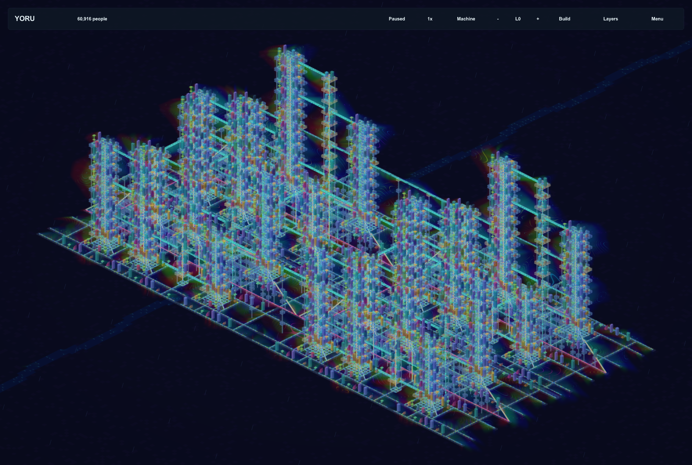
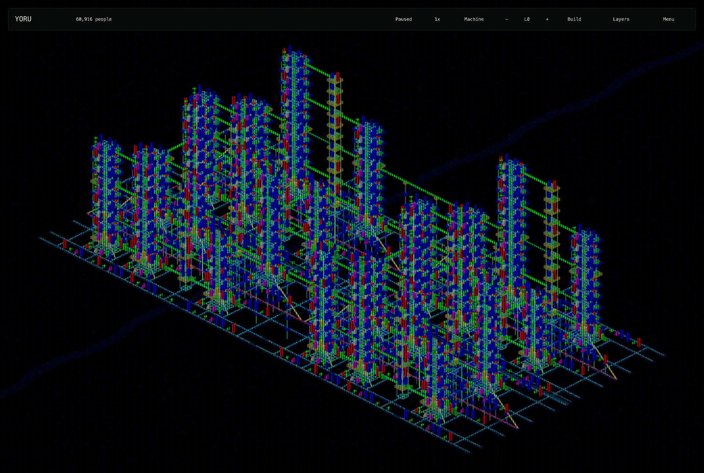
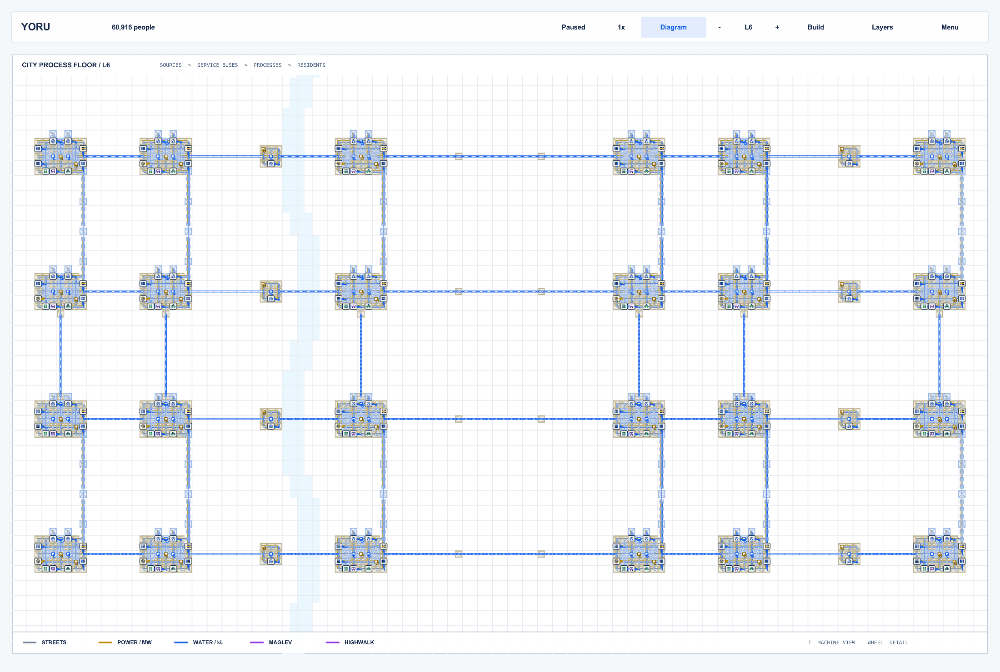

# New Tokyo / Yoru Tokyo

An open-ended cyberpunk city builder set in Tokyo, built around **city as machine**: buildings, services, people and goods share real networks across multiple floors.

Version **1.26.0** is a native C++17 application using bundled raylib and nlohmann/json. It has an optical machine view and a shared top-down diagram view. The expanded demo spans **154 × 70 tiles**, with **2,592 buildings**, **60,916 initial residents** and an **L0–L12** skyline.

## Screenshots

The expanded demo from the same camera angle in both graphics modes, followed by the level-six floor plan. RGB phosphor is a preview from v1.27.

### Original optics



### RGB phosphor



### Diagram view



## Building and playing

- **Tab / Build** opens the construction catalogue; **/** focuses quick search. Search buildings, roads, utilities, lifts, bridges, structural parts and reusable plans. Use **Up / Down** and **Enter** to select.
- **Click or drag** to place buildings and networks. **U** or **Cmd/Ctrl-Z** undoes the whole last construction stroke before the next simulation tick.
- **I** copies an existing building's type and chooses its floor. The inspector also offers **Build another**.
- **[ / ]** changes the construction level. Selecting a tool pauses the city, zooms in and cuts away higher floors. **Esc / Q** finishes construction and restores the previous stack view.
- Assisted routes preview decks and bearing cores. Choose landings and floors, then **Enter** to commit the complete route.
- **T** switches machine and diagram views. **Wheel** zooms, **right-drag / WASD** pans, and **F** fits the city.
- **Space** runs or pauses; **.** advances one tick. **L** opens engineering layers, **N** opens individual vertical construction tools, **M** opens the machine kernel, **J** defines districts, and **G** traces dependencies.
- **H** opens the guide. **F2** hides the UI, **F3** shows performance statistics, and **F4** cycles rendering quality.

## Build

Requirements: CMake 3.20 or newer and a C++17 compiler. Dependencies are vendored under `vendor/`. macOS is the verified desktop target; the project also has Windows and Linux build paths. Linux needs the native development libraries required by raylib's desktop OpenGL/GLFW backend.

```sh
cmake -S . -B build -DCMAKE_BUILD_TYPE=Release -DBUILD_TESTING=ON
cmake --build build --config Release -j 2
ctest --test-dir build -C Release --output-on-failure
```

On macOS, `./build.sh` builds, runs the model tests and installs an ad-hoc signed `Yoru Tokyo.app` in the project folder. Open that app or use one of the `Start … .command` launchers. The CMake bundle is also available at `build/YoruTokyo.app`.

For the model and tests without a graphics application:

```sh
cmake -S . -B build-model -DYORU_BUILD_APP=OFF -DBUILD_TESTING=ON
cmake --build build-model -j 2
ctest --test-dir build-model --output-on-failure
```

`-DYORU_SANITIZE=ON` enables address and undefined-behavior sanitizers.

## City profiles

Normal launch resumes the expanded demo. `--demo-2x` selects it explicitly, `--demo` selects the original large demo, and `--starter` opens the compact city. New City offers expanded, original, starter and blank cities.

Saves are stored in the platform's application-data folder, separately from the source checkout. `YORU_DATA_DIR` chooses an isolated save root for testing. Expanded and original demos use separate `megacity-2x/` and `megacity-dense/` profiles. Use `--help` for all diagnostic and benchmark options.

## Validation and notes

Version 1.26 passed all 17 CTest suites and native checks for easier building, minimal UI, vertical construction, routes and tracing, render caches and optical navigation. The construction checks cover batched placement, costs and starting inventory, shared preview rules, whole-stroke undo and assisted supports.

- [Complete guide and release notes](README.txt)
- [Validation record](VALIDATION.txt)
- [Rendering and construction performance notes](RENDER-PERFORMANCE.txt)
- [Verticality research](VERTICALITY-RESEARCH.txt)
- [Provenance and third-party attribution](ORIGIN.txt)

Bundled third-party code retains its own license notices in `vendor/`.
